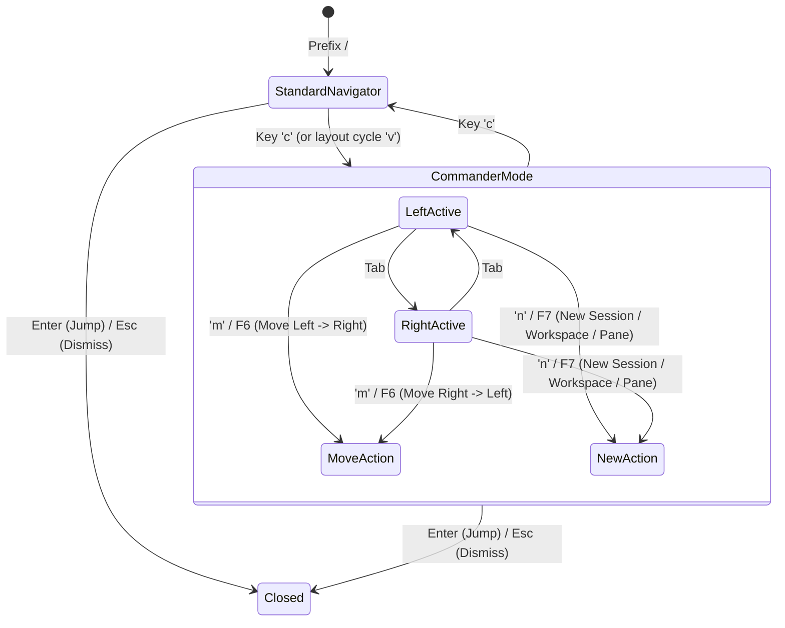

# Decision Record 0001: Pane Commander Mode (`feat/pane-commander`)

## 1. Context & Problem Statement
In `tuios`, managing windows across workspaces and sessions is handled via keybindings or CLI verbs (`move-window`, `set-workspace-order`). When many long-running sessions and agent panes exist simultaneously, cross-workspace and cross-session triage is tedious without a high-level visual window manager.

The `choose_tree` Navigator provides a single-panel tree with a preview pane, but cannot move items interactively.

## 2. Decision: Dual-Panel Orthogonal Commander Mode
Enhance the Navigator with an opt-in dual-panel mode (Norton/Midnight Commander style), toggled via `c`.



### State Definition (`navigatorState` in `internal/app/navigator.go`)
* `commander bool`: Commander layout active.
* `activeSide int`: 0 for Left, 1 for Right.
* `rightList listnav.State`: Independent cursor, scroll, and viewport for Right panel.
* `cmdNotice string`: Status/error feedback string.
* `cmdPrompt string`: Modal prompt string (`"new"`, `"close"`).

---

## 3. BDD Scenarios (Executable Contracts)

### Feature 1: Mode Activation & Layout Geometry
```gherkin
Scenario: Toggle Commander Mode from Standard Navigator
  Given the Navigator is open in standard mode (Tree + Preview)
  When the user presses "c"
  Then the layout switches to Commander mode
  And the right-hand Preview box is replaced by the Right Tree panel
  And the Left panel is initially active (activeSide = 0)
  And the footer hints display "[Tab] panel  [m] move  [n] new  [c] normal  [Enter] go"

Scenario: Toggle Back to Standard Navigator
  Given Commander mode is active
  When the user presses "c"
  Then Commander mode is deactivated
  And the right-hand box reverts to the live pane Preview
```

### Feature 2: Dual-Panel Focus & Independent Navigation
```gherkin
Scenario: Switching Active Panel with Tab
  Given Commander mode is active with Left panel focused
  When the user presses "Tab"
  Then the active panel becomes Right (activeSide = 1)
  And navigation keys (j, k, h, l, space) now control the Right panel
  And the Left panel retains its cursor and scroll position
  When the user presses "Tab" again
  Then the active panel returns to Left (activeSide = 0)

Scenario: Independent Cursor Navigation
  Given Commander mode is active with Left focused on Session "toolings" / Workspace 1
  When the user presses "Tab" to focus Right
  And moves the cursor down to Session "airesearch" / Workspace 3
  Then the Left cursor remains on Workspace 1
  And the Right cursor is positioned on Workspace 3
```

### Feature 3: Move Operation (`m` or `F6`)
```gherkin
Scenario: Move Pane across Workspaces in the Same Session
  Given the active panel is positioned on Pane "build" (session "work", workspace 1)
  And the opposite panel is positioned on Workspace 2 in session "work"
  When the user presses "m"
  Then the verb "move-window" is dispatched with:
    | window    | <build-pane-id> |
    | session   | "work"          |
    | workspace | 2               |
  And both panels refresh their trees
  And a status notice "Moved pane 'build' to workspace 2" is displayed

Scenario: Move Pane across Different Sessions
  Given the active panel is positioned on Pane "test" (session "work", workspace 1)
  And the opposite panel is positioned on Session "review" / Workspace 2
  When the user presses "m"
  Then the verb "move-window" is dispatched with:
    | window     | <test-pane-id> |
    | session    | "work"         |
    | to_session | "review"       |
    | workspace  | 2              |
  And both panels refresh their trees
```

### Feature 4: Create Resource (`n` or `F7`)
```gherkin
Scenario: Quick-Create Submenu
  Given Commander mode is active
  When the user presses "n"
  Then prompt options appear: "[s] Session  [w] Workspace  [p] Pane  [esc] Cancel"
  When the user presses "w"
  Then a new workspace is created under the active session
  And the tree refreshes
```

### Feature 5: Direct Activation (`Enter`)
```gherkin
Scenario: Jump to Selected Pane
  Given Commander mode is active with Right panel focused on Pane "antigravity"
  When the user presses "Enter"
  Then Commander closes
  And tuios immediately switches to Pane "antigravity"
```

---

## 4. Multi-Session Tree Visibility & Default Expansion
### Root Cause
In upstream `tuios`, `navigatorRows()` evaluated `m.navExpanded(s.key(), s.Current)`. Non-current sessions (`s.Current == false`) defaulted to collapsed, hiding all foreign panes unless manually opened.

### Solution
1. `panes.navigator_expand_all` (default: `false`): Open all sessions in standard Navigator.
2. `panes.commander_expand_all` (default: `true`): Explicitly overrides for Commander mode.
3. Empty named workspaces in `s.WorkspaceNames` are included in `s.workspaces()` to allow drops into empty workspaces.

---

## 5. Proactive Move Preview & Sibling Placement
1. **Real-Time Action Preview**: Top search bar continuously renders preview before `m` is pressed (`→ Move ...` in green when valid, `✕ Invalid ...` in warning/muted when invalid).
2. **Context Hints**: `m move` when valid vs `m move (off)` when invalid.
3. **Sibling Placement**: Dropping a pane onto another pane places it underneath (`side: "down"` via daemon layout `beside`).
4. **Workspace Reordering**: Dropping a workspace onto another in the same session calls `set-workspace-order`.
